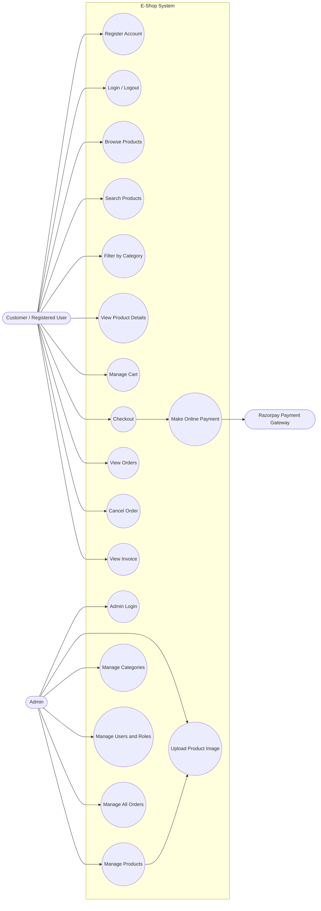
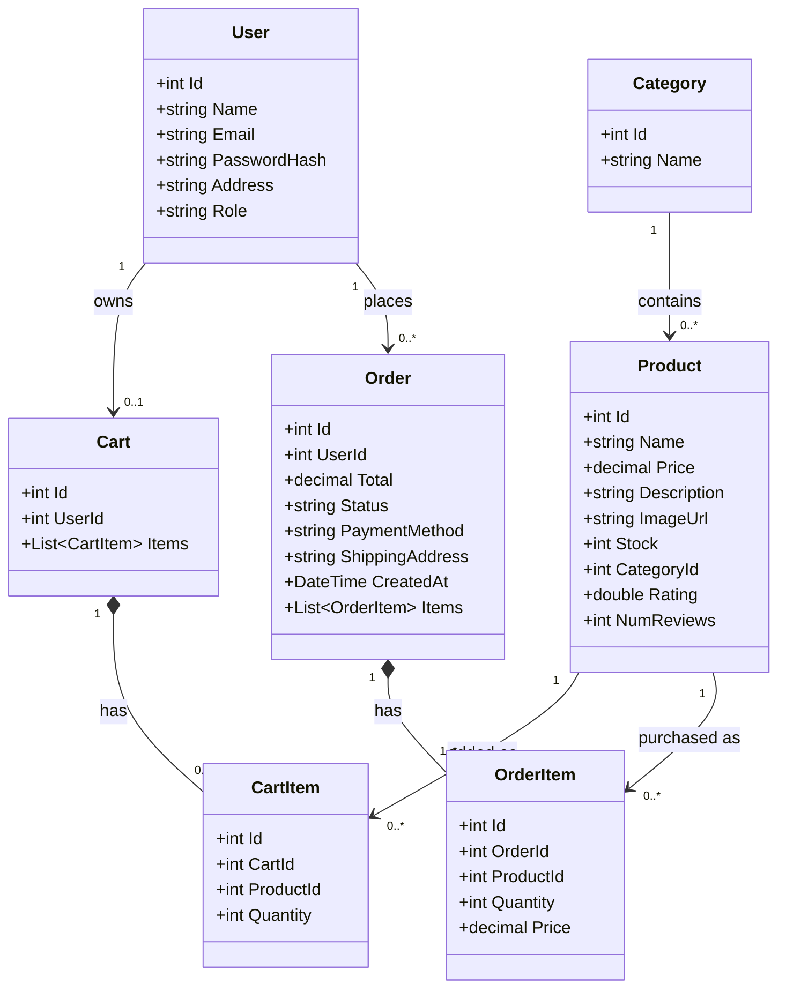
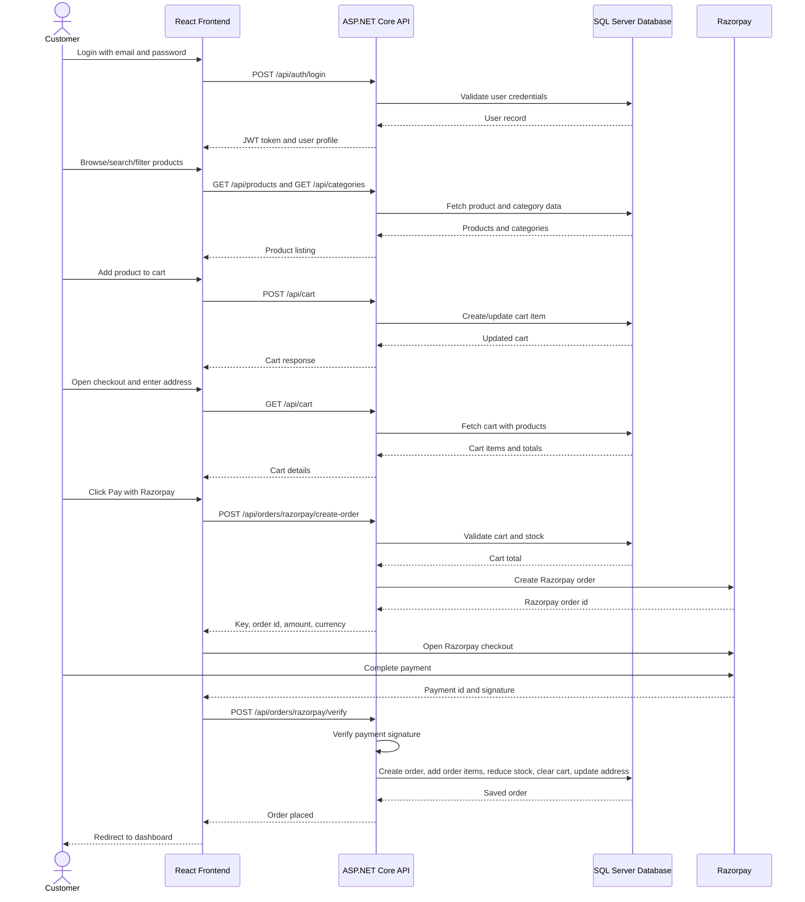
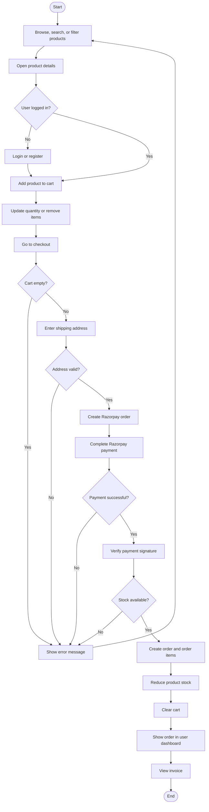

# 3. System Design

This section describes the system design for the E-Shop project. The application is a React frontend connected to an ASP.NET Core Web API, SQL Server database, JWT authentication, role-based authorization, and Razorpay payment flow.

## 3.1. Use Case Diagram

## 3.2. Class Diagram

## 3.3. Interaction Diagram

The main interaction flow is the customer checkout and payment process.

## 3.4. Activity Diagram

## 3.5. Data Dictionary

### Users

Stores customer and admin account information. The first registered user becomes an admin, and all other users are created with the user role by default.

| Field | Type | Key / Constraint | Description |
| --- | --- | --- | --- |
| Id | int | Primary Key, Identity | Unique user identifier. |
| Name | nvarchar(max) | Required | Full name of the user. |
| Email | nvarchar(450) | Required, Unique Index | User login email address. |
| PasswordHash | nvarchar(max) | Required | BCrypt hashed password. |
| Address | nvarchar(max) | Required | Saved shipping address, updated during checkout. |
| Role | nvarchar(max) | Required | User role: `Admin` or `User`. |

### Categories

Stores product category records used for filtering and organizing the catalog.

| Field | Type | Key / Constraint | Description |
| --- | --- | --- | --- |
| Id | int | Primary Key, Identity | Unique category identifier. |
| Name | nvarchar(max) | Required | Category name, such as Mobile, Laptop, Audio, Gaming, or Accessories. |

### Products

Stores product catalog details displayed in the storefront and managed by admins.

| Field | Type | Key / Constraint | Description |
| --- | --- | --- | --- |
| Id | int | Primary Key, Identity | Unique product identifier. |
| Name | nvarchar(max) | Required | Product name. |
| Price | decimal(18,2) | Required | Product selling price. |
| Description | nvarchar(max) | Required | Product description. |
| ImageUrl | nvarchar(max) | Required | Relative or external image URL. Uploaded images are stored under `/images/products`. |
| Stock | int | Required | Available inventory count. Reduced after successful order placement. |
| CategoryId | int | Foreign Key to Categories.Id | Category assigned to the product. Delete behavior is restricted at the database relationship level. |
| Rating | float | Required, Default 0 | Average product rating value. |
| NumReviews | int | Required, Default 0 | Number of reviews used for rating. |

### Carts

Stores one shopping cart per user when the user views or adds cart items.

| Field | Type | Key / Constraint | Description |
| --- | --- | --- | --- |
| Id | int | Primary Key, Identity | Unique cart identifier. |
| UserId | int | Foreign Key to Users.Id | User who owns the cart. Cascade delete is configured from user to cart. |

### CartItems

Stores individual product lines inside a user's cart.

| Field | Type | Key / Constraint | Description |
| --- | --- | --- | --- |
| Id | int | Primary Key, Identity | Unique cart item identifier. |
| CartId | int | Foreign Key to Carts.Id | Cart that contains this item. Cascade delete removes cart items when the cart is removed. |
| ProductId | int | Foreign Key to Products.Id | Product added to the cart. |
| Quantity | int | Required | Quantity selected by the user. API validation allows 1 to 100. |

### Orders

Stores customer order headers after checkout or successful Razorpay payment verification.

| Field | Type | Key / Constraint | Description |
| --- | --- | --- | --- |
| Id | int | Primary Key, Identity | Unique order identifier. |
| UserId | int | Foreign Key to Users.Id | User who placed the order. Cascade delete is configured from user to order. |
| Total | decimal(18,2) | Required | Total order amount calculated from cart item quantities and product prices. |
| Status | nvarchar(max) | Required, Default `Pending` | Current order status: `Pending`, `Shipped`, `Delivered`, or `Cancelled`. |
| PaymentMethod | nvarchar(max) | Required | Payment method or Razorpay payment reference. |
| ShippingAddress | nvarchar(max) | Required | Delivery address used for the order. |
| CreatedAt | datetime2 | Required, Default current UTC time | Date and time when the order was created. |

### OrderItems

Stores product line items for each order. The price is copied at order time so the invoice can keep the original purchase price.

| Field | Type | Key / Constraint | Description |
| --- | --- | --- | --- |
| Id | int | Primary Key, Identity | Unique order item identifier. |
| OrderId | int | Foreign Key to Orders.Id | Order that contains this line item. Cascade delete removes order items when the order is removed. |
| ProductId | int | Foreign Key to Products.Id | Product purchased in the order. |
| Quantity | int | Required | Purchased quantity. |
| Price | decimal(18,2) | Required | Unit price captured at the time of order creation. |

### Relationship Summary

| Relationship | Cardinality | Description |
| --- | --- | --- |
| Users to Carts | 1 to 0..1 | A user can have one active cart created on demand. |
| Users to Orders | 1 to many | A user can place multiple orders. |
| Categories to Products | 1 to many | A category can contain multiple products. |
| Carts to CartItems | 1 to many | A cart can contain multiple product lines. |
| Products to CartItems | 1 to many | A product can appear in many cart items. |
| Orders to OrderItems | 1 to many | An order contains one or more order line items. |
| Products to OrderItems | 1 to many | A product can appear in many order line items. |
